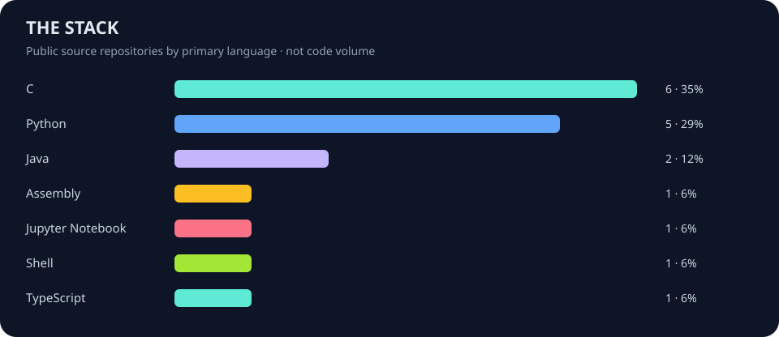

<p align="center"></p>

<p align="center"><strong>A living developer journal. Public APIs in, useful daily signals out.</strong></p>
<p align="center"><a href="digests/README.md">Daily issues</a> · <a href="plans/README.md">AI planning journal</a> · <a href="data/latest.json">Open data</a> · <a href="https://github.com/Mr-Amir-Al-Rashayda">My GitHub</a></p>

[Open today's full issue →](digests/2026/11/2026-11-21.md)

## AI next move

**Reviewed 2026-11-21 by local Codex · Proposed, not implemented**

### Make the backup transport send bytes, with a real socket test

**Project:** [cloud-backup-system](https://github.com/Mr-Amir-Al-Rashayda/cloud-backup-system) · **Estimated effort:** About 2-3 hours on Linux or WSL, including focused socket tests

Turn one foundational networking stub into a working, verifiable transport primitive. A reliable send-all function is reusable by both file transfers and protocol headers, and gives the backup project an honest first end-to-end byte-transfer demonstration.

**Why this next:** Fresh November 21 review compared current READMEs and relevant code in three eligible public projects. Backup head adf40a00b1c806972c8dbd28acc7284f3ba19749 still has network\_send\_all ignoring every argument and returning success, and test\_network only checks buffer initialization. These are documented coursework stubs. Channel head 7de3a92172110be2615dc561abd009f13610f7de still assumes valid matrices, and scheduler head e2f991f07db966acf75ec861efc617d0478a7327 still hardcodes input and always plots. The existing backup implementation, test and formatted-line proposals have not become implementations in the inspected source. Retaining a socket-tested byte-transfer primitive remains the most foundational bounded improvement; the numerical CLI and scheduler CLI offer credible usability gains at similar effort but do not unblock transport. Do not advance to dependent formatted-line work yet. This run inspected source only for those projects; their C, numerical and scheduler suites were not executed.

*Carried forward after reviewing the previous recommendation.*

**Implementation outline**

1. Implement only network\_send\_all against its existing header contract: advance through short writes, retry interrupted sends, and return an error on actual failure or a zero-progress send instead of looping forever or reporting success.
2. Define and document edge cases for zero-length input and invalid arguments. Choose a platform-appropriate SIGPIPE policy so sending to a disconnected peer returns an error instead of unexpectedly terminating the process; retain the project's stated Linux/macOS portability where supported.
3. Extend test\_network with an actual socketpair transfer and an independent receiver, comparing an exact binary payload including zero bytes. Drain large payloads concurrently so the test cannot deadlock on socket-buffer capacity.
4. Add focused short-write and EINTR coverage through a controlled test seam or equivalent deterministic technique, plus disconnected-peer and zero-length cases. Run the existing make test and CI workflow and document that other networking functions remain stubs.

**Acceptance checks**

- [ ] A local socketpair receiver obtains the exact payload and byte count for both a small binary buffer and a payload larger than normal socket-buffer capacity.
- [ ] Deterministic short writes and interrupted calls complete correctly without dropped or duplicated bytes; zero-progress and permanent errors terminate with the documented error result.
- [ ] A disconnected peer does not produce a false success or unexpected SIGPIPE process termination, and the zero-length case behaves as documented.
- [ ] Existing project tests still pass, the new transport tests actually exercise network\_send\_all, and documentation does not claim the remaining listener, receive, or connection stubs are complete.

**Evidence inspected**

- [Source 1](https://github.com/Mr-Amir-Al-Rashayda/cloud-backup-system/blob/adf40a00b1c806972c8dbd28acc7284f3ba19749/src/common/network.c): Read November 21 at unchanged backup head: network\_send\_all discards sockfd, data and count and returns zero unconditionally; network\_send\_line and other transport helpers also remain explicit stubs.
- [Source 2](https://github.com/Mr-Amir-Al-Rashayda/cloud-backup-system/blob/adf40a00b1c806972c8dbd28acc7284f3ba19749/tests/test_network.c): Read November 21: the network test initializes recv\_buf\_t and checks zero len/start. It does not open sockets or invoke network\_send\_all.
- [Source 3](https://github.com/Mr-Amir-Al-Rashayda/accelerated-blahut-arimoto/blob/7de3a92172110be2615dc561abd009f13610f7de/Code/ba_core.py): Read November 21 at unchanged solver head: blahut\_arimoto converts W, unpacks W.shape and starts probability calculations without explicit channel-matrix validation.
- [Source 4](https://github.com/Mr-Amir-Al-Rashayda/CPU-Scheduler-Simulation/blob/e2f991f07db966acf75ec861efc617d0478a7327/OS_Amir.py): Read November 21 at unchanged scheduler head: main hardcodes Processes.txt and a quantum of 10, prints metrics, then unconditionally calls generate\_gantt\_chart.
- [Source 5](https://github.com/Mr-Amir-Al-Rashayda/CPU-Scheduler-Simulation/blob/e2f991f07db966acf75ec861efc617d0478a7327/README.md): Read November 21: the README describes a file-driven interactive scheduler workflow with console metrics and a Matplotlib Gantt window.
- [Source 6](https://github.com/Mr-Amir-Al-Rashayda/cloud-backup-system/blob/adf40a00b1c806972c8dbd28acc7284f3ba19749/README.md): Read November 21: the README explicitly labels src as implementation skeletons and stubs and documents reliable framing, make all and make test as part of the coursework project.
- [Source 7](https://github.com/Mr-Amir-Al-Rashayda/accelerated-blahut-arimoto/blob/7de3a92172110be2615dc561abd009f13610f7de/README.md): Read November 21: the README explicitly says the supplied solvers assume valid matrices, documents natural-log gap units, and warns that reaching the iteration limit does not ensure convergence.

**Other ideas considered**

- **accelerated-blahut-arimoto — Build the previously proposed validated custom-channel runner:** A validated custom-channel runner would help students supply safe inputs, at an estimated 2-4 hours. Current README and ba\_core.py provide strong evidence, but this repeats an existing unimplemented usability proposal; making the backup transport actually send bytes offers a more foundational functional gain with a precise receiver-based check.
- **CPU-Scheduler-Simulation — Add configurable input and a headless metrics mode:** A configurable headless scheduler would improve repeatable classroom runs, at an estimated 2-4 hours plus metrics verification. Current main and README confirm fixed input and interactive plotting. Its usability benefit is credible, but transport behavior has a narrower directly observable acceptance boundary and remains an unmet prerequisite.


## Project spotlight

### [accelerated-blahut-arimoto](https://github.com/Mr-Amir-Al-Rashayda/accelerated-blahut-arimoto)

Channel-capacity estimation in Python: Blahut-Arimoto, relaxed updates, analytic validation and the accompanying research paper.

**Stack:** Python · **Stars:** 0

## One small portfolio improvement

Add a one-line description to [Medical-Test-Management-System](https://github.com/Mr-Amir-Al-Rashayda/Medical-Test-Management-System). Explain the problem it solves and its main technology. This is a suggestion; no changes were made to that project.

## Around the developer community

Top Hacker News stories at collection time. Community links, not endorsements.

- [Derek Lowe: Detonating a Pile of Lead Azide](https://www.science.org/content/blog-post/detonating-huge-pile-lead-azide-really) — 125 points · [77 comments](https://news.ycombinator.com/item?id=50588982)
- [Brazil's tax authority open-sources its tax calculator on GitHub under MIT](https://www.gov.br/receitafederal/pt-br/assuntos/noticias/2026/novembro/receita-federal-publica-primeiro-codigo-fonte-aberto-no-github-e-amplia-transparencia-da-reforma-tributaria) — 314 points · [103 comments](https://news.ycombinator.com/item?id=50532613)
- [Lean Verification of the Riemann Hypothesis - Joint statement by...](https://leanprover-community.github.io/blog/posts/riemann-hypothesis/) — 21 points · [12 comments](https://news.ycombinator.com/item?id=50589618)
- [Astra 6.2 and Sol 6.2 flop at Simple Bench](https://simple-bench.com/) — 52 points · [33 comments](https://news.ycombinator.com/item?id=50588916)
- [My Monitor Was Cutting My Download Speed by 75%](https://blog.tymscar.com/posts/studiodisplayethernet/) — 155 points · [63 comments](https://news.ycombinator.com/item?id=50587875)

## Read & learn

Popular programming articles on DEV. Original articles stay with their authors.

- [Cozy Bytes 🍺 \| Rust::Who Owns the Cat? 🐈🦀](https://dev.to/_yourbrainbuffer_/cozy-bytes-rustwho-owns-the-cat-13ch) · 2 min read
- [I Haven't Written a Line of Code in Months. And I Don't Know How to Feel About It.](https://dev.to/damcosset/on-finding-purpose-kk6) · 3 min read
- [We Tried Automating Notifications with Make. Here's What We Learned.](https://dev.to/notifizz/we-tried-automating-notifications-with-make-heres-what-we-learned-1nhp) · 5 min read
- [The Best Cyberdeck Is Not the Most Powerful One. It Is the One You Actually Carry](https://dev.to/numbpill3d/the-best-cyberdeck-is-not-the-most-powerful-one-it-is-the-one-you-actually-carry-22o5) · 10 min read
- [A VS Code extension to turn ANY free chatbot website into an AI agent (kind of)](https://dev.to/effessdev/a-vs-code-extension-to-turn-any-free-chatbot-website-into-an-ai-agent-kind-of-1n21) · 7 min read

## My public project mix



## Source freshness

| Source | Status | Last successful fetch (UTC) |
| :-- | :-- | :-- |
| github | live | 2026-11-21 15:21 UTC |
| hacker_news | live | 2026-11-21 15:21 UTC |
| dev | live | 2026-11-21 15:21 UTC |

## How it works

GitHub Actions runs daily at **07:17 UTC** (09:17 in Hebron during standard time; 10:17 during daylight time). Python collects public repository metadata, Hacker News stories, and DEV programming articles, then builds this README, accessible SVG graphics, a JSON snapshot, and a dated Markdown issue.

Updates contain real source data. An issue is generated at most once per date. Each API is fetched independently with timeouts and retries. If an API fails, its last successful snapshot is marked **cached**. If every API fails, the existing dashboard is preserved and the run fails visibly. GitHub may delay scheduled runs. The previous random commit batches have been replaced by one useful daily briefing.

### Run it yourself

```sh
python3 scripts/publish_daily.py
python3 -m unittest discover -s tests -v
```

Python 3.10+ and an IANA timezone database are required (included on GitHub's Ubuntu runner). Windows users may need `pip install tzdata`. No paid APIs or external API keys are required. The workflow uses its built-in token only for GitHub requests and pushing to this repository.

### Local AI planner

Local Codex reviews real project documentation and code, compares three possible tasks, and publishes one evidence-backed recommendation with an implementation outline and acceptance checks. It reads the planning journal before deciding, so an unfinished useful task can be carried forward instead of inventing a new one every day. Proposals are dated and never presented as completed work.

The AI review runs daily at **23:00 Asia/Hebron (11 PM)** through a local Codex scheduled task. **This computer must be awake and Codex running.** It uses the existing Codex session, with no separate model API key. The GitHub-hosted daily brief continues independently. If the local planner misses a run, the last proposal keeps its original review date. See [PLANNER.md](PLANNER.md) for the procedure and publication format.

**API references:** [GitHub](https://docs.github.com/en/rest/repos/repos), [Hacker News](https://github.com/HackerNews/API), [DEV / Forem](https://developers.forem.com/api).

**Controls:** Run the workflow manually from Actions; check its refresh option to rebuild today's issue after recovering an API. Disable the workflow there to stop updates. Other projects are only read; portfolio suggestions do not edit them. The original Python exercises remain in [examples/](examples/).
