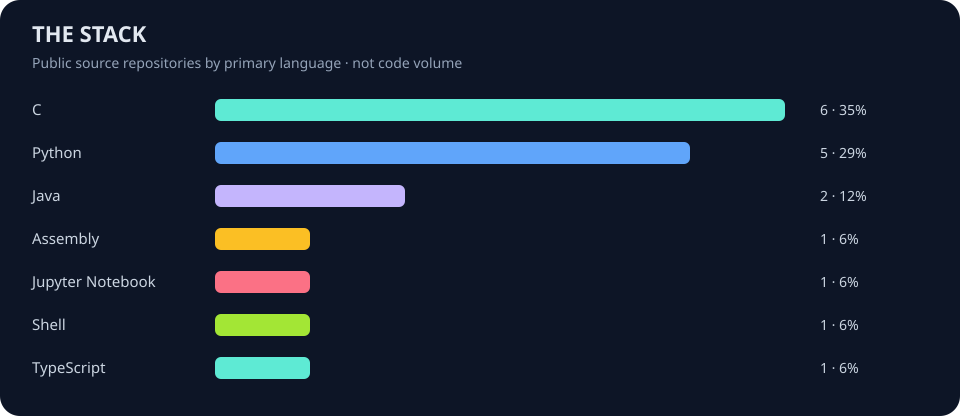

<p align="center"></p>

<p align="center"><strong>A living developer journal. Public APIs in, useful daily signals out.</strong></p>
<p align="center"><a href="digests/README.md">Daily issues</a> · <a href="plans/README.md">AI planning journal</a> · <a href="data/latest.json">Open data</a> · <a href="https://github.com/Mr-Amir-Al-Rashayda">My GitHub</a></p>

[Open today's full issue →](digests/2026/11/2026-11-14.md)

## AI next move

**Reviewed 2026-11-12 by local Codex · Proposed, not implemented**

### Make the backup transport send bytes, with a real socket test

**Project:** [cloud-backup-system](https://github.com/Mr-Amir-Al-Rashayda/cloud-backup-system) · **Estimated effort:** About 2-3 hours on Linux or WSL, including focused socket tests

Turn one foundational networking stub into a working, verifiable transport primitive. A reliable send-all function is reusable by both file transfers and protocol headers, and gives the backup project an honest first end-to-end byte-transfer demonstration.

**Why this next:** This review expanded beyond the previous candidates and found a stronger, tightly scoped opportunity. At backup-project revision adf40a00b1c806972c8dbd28acc7284f3ba19749, network.h promises that network\_send\_all sends every byte, but network.c ignores all its arguments and returns success. The existing network test only checks receive-buffer initialization, so it does not verify the send contract. These are explicitly marked implementation stubs, not an undisclosed production regression. Implementing and testing this single primitive has more immediate functional value than another presentation improvement and is smaller than completing the whole backup service. The earlier channel runner is still useful and unimplemented in its unchanged inspected revision, but a no-op transport that reports success now takes priority. Source and test files were reviewed; no C or scheduler tests were executed in this planning review.

**Implementation outline**

1. Implement only network\_send\_all against its existing header contract: advance through short writes, retry interrupted sends, and return an error on actual failure or a zero-progress send instead of looping forever or reporting success.
2. Define and document edge cases for zero-length input and invalid arguments. Choose a platform-appropriate SIGPIPE policy so sending to a disconnected peer returns an error instead of unexpectedly terminating the process; retain the project's stated Linux/macOS portability where supported.
3. Extend test\_network with an actual socketpair transfer and an independent receiver, comparing an exact binary payload including zero bytes. Drain large payloads concurrently so the test cannot deadlock on socket-buffer capacity.
4. Add focused short-write and EINTR coverage through a controlled test seam or equivalent deterministic technique, plus disconnected-peer and zero-length cases. Run the existing make test and CI workflow and document that other networking functions remain stubs.

**Acceptance checks**

- [ ] A local socketpair receiver obtains the exact payload and byte count for both a small binary buffer and a payload larger than normal socket-buffer capacity.
- [ ] Deterministic short writes and interrupted calls complete correctly without dropped or duplicated bytes; zero-progress and permanent errors terminate with the documented error result.
- [ ] A disconnected peer does not produce a false success or unexpected SIGPIPE process termination, and the zero-length case behaves as documented.
- [ ] Existing project tests still pass, the new transport tests actually exercise network\_send\_all, and documentation does not claim the remaining listener, receive, or connection stubs are complete.

**Evidence inspected**

- [Source 1](https://github.com/Mr-Amir-Al-Rashayda/cloud-backup-system/blob/adf40a00b1c806972c8dbd28acc7284f3ba19749/include/network.h): The network\_send\_all contract explicitly requires looping around send until all bytes are transferred, returning zero on success and minus one on error.
- [Source 2](https://github.com/Mr-Amir-Al-Rashayda/cloud-backup-system/blob/adf40a00b1c806972c8dbd28acc7284f3ba19749/src/common/network.c): The inspected network\_send\_all is marked as a stub, casts sockfd, data, and count to void, and unconditionally returns zero. Other networking functions are also marked as stubs.
- [Source 3](https://github.com/Mr-Amir-Al-Rashayda/cloud-backup-system/blob/adf40a00b1c806972c8dbd28acc7284f3ba19749/tests/test_network.c): The current test initializes recv\_buf\_t and asserts that len and start are zero. It does not create sockets or call network\_send\_all.
- [Source 4](https://github.com/Mr-Amir-Al-Rashayda/cloud-backup-system/blob/adf40a00b1c806972c8dbd28acc7284f3ba19749/.github/workflows/ci.yml): The existing Ubuntu CI installs build dependencies and runs make all and make test, providing an existing place for a real transport regression test.
- [Source 5](https://github.com/Mr-Amir-Al-Rashayda/accelerated-blahut-arimoto/blob/7de3a92172110be2615dc561abd009f13610f7de/Code/ba_core.py): Fresh inspection confirms the solver still converts W and unpacks W.shape without explicit channel-matrix validation. The previously proposed custom-channel runner remains a worthwhile alternative.
- [Source 6](https://github.com/Mr-Amir-Al-Rashayda/CPU-Scheduler-Simulation/blob/e2f991f07db966acf75ec861efc617d0478a7327/OS_Amir.py): The inspected main function hardcodes Processes.txt, runs the simulation, prints metrics, and unconditionally calls generate\_gantt\_chart; it exposes no command-line input or no-plot option in this entry point.
- [Source 7](https://github.com/Mr-Amir-Al-Rashayda/CPU-Scheduler-Simulation/blob/e2f991f07db966acf75ec861efc617d0478a7327/README.md): The README describes a file-driven scheduler with waiting and turnaround metrics, logs, and a Matplotlib window, making repeatable headless execution a plausible usability improvement.

**Other ideas considered**

- **accelerated-blahut-arimoto — Build the previously proposed validated custom-channel runner:** Still useful and supported by the unchanged source and README. However, replacing a backup transport no-op with an actual byte-transfer primitive provides a more foundational functional gain at a similar or smaller estimated effort. The earlier proposal is not marked completed.
- **CPU-Scheduler-Simulation — Add configurable input and a headless metrics mode:** The hardcoded input path and unconditional plotting in main make this a credible usability task. A reliable metrics-output contract needs more examination of scheduler behavior and expected results; the backup send contract and missing test are already precise.


## Project spotlight

### [P2](https://github.com/Mr-Amir-Al-Rashayda/P2)

Explore the source and documentation for this project.

**Stack:** Not reported · **Stars:** 0

## One small portfolio improvement

Add a one-line description to [-6-bit-Signed-Unsigned-Comparator-in-Verilog](https://github.com/Mr-Amir-Al-Rashayda/-6-bit-Signed-Unsigned-Comparator-in-Verilog). Explain the problem it solves and its main technology. This is a suggestion; no changes were made to that project.

## Around the developer community

Top Hacker News stories at collection time. Community links, not endorsements.

- [Why get an expensive Pi when I have an old phone?](https://so.long.thanks.fish/why-pi-when-i-have-an-old-phone/) — 217 points · [143 comments](https://news.ycombinator.com/item?id=50440709)
- [Generative AI uses more energy on non-English text](https://news.umich.edu/generative-ai-uses-more-energy-on-non-english-text/) — 22 points · [11 comments](https://news.ycombinator.com/item?id=50441444)
- [Ggml v1.0.0](https://github.com/ggml-org/ggml/releases/tag/v1.0.0) — 324 points · [50 comments](https://news.ycombinator.com/item?id=50493062)
- [Monkey Island: all 13 versions side by side](https://monkeyisland.pages.dev/) — 265 points · [83 comments](https://news.ycombinator.com/item?id=50493904)
- [Tech Companies Are Trying to Shift the Concept of Privacy (Again)](https://www.eff.org/deeplinks/2026/11/tech-companies-are-trying-shift-entire-concept-privacy-again) — 61 points · [7 comments](https://news.ycombinator.com/item?id=50496602)

## Read & learn

Popular programming articles on DEV. Original articles stay with their authors.

- [Biology's Best Algorithms Aren't Just for Scientists Anymore](https://dev.to/copyleftdev/biologys-best-algorithms-arent-just-for-scientists-anymore-50al) · 4 min read
- [🕯️…and then I extracted JSONL from Gemini ...create the tools, and then what next?...](https://dev.to/ggle_in/and-then-i-extracted-jsonl-from-gemini-create-the-tools-and-then-what-next-2h05) · 6 min read
- [A Million v7 GUIDs and Half Were Still Out of Order](https://dev.to/ssukhpinder/a-million-v7-guids-and-half-were-still-out-of-order-20k6) · 6 min read
- [I Sorted Two Million Rows to Keep Ten](https://dev.to/ssukhpinder/i-sorted-two-million-rows-to-keep-ten-20np) · 4 min read
- [Git 2.56's history-drop Is 40-77x Faster Than Rebase — I Built It and Got 6x](https://dev.to/aheadkit/git-256s-history-drop-is-40-77x-faster-than-rebase-i-built-it-and-got-6x-gai) · 6 min read

## My public project mix



## Source freshness

| Source | Status | Last successful fetch (UTC) |
| :-- | :-- | :-- |
| github | live | 2026-11-14 14:08 UTC |
| hacker_news | live | 2026-11-14 14:08 UTC |
| dev | live | 2026-11-14 14:08 UTC |

## How it works

GitHub Actions runs daily at **07:17 UTC** (09:17 in Hebron during standard time; 10:17 during daylight time). Python collects public repository metadata, Hacker News stories, and DEV programming articles, then builds this README, accessible SVG graphics, a JSON snapshot, and a dated Markdown issue.

Updates contain real source data. An issue is generated at most once per date. Each API is fetched independently with timeouts and retries. If an API fails, its last successful snapshot is marked **cached**. If every API fails, the existing dashboard is preserved and the run fails visibly. GitHub may delay scheduled runs. The previous random commit batches have been replaced by one useful daily briefing.

### Run it yourself

```sh
python3 scripts/publish_daily.py
python3 -m unittest discover -s tests -v
```

Python 3.10+ and an IANA timezone database are required (included on GitHub's Ubuntu runner). Windows users may need `pip install tzdata`. No paid APIs or external API keys are required. The workflow uses its built-in token only for GitHub requests and pushing to this repository.

### Local AI planner

Local Codex reviews real project documentation and code, compares three possible tasks, and publishes one evidence-backed recommendation with an implementation outline and acceptance checks. It reads the planning journal before deciding, so an unfinished useful task can be carried forward instead of inventing a new one every day. Proposals are dated and never presented as completed work.

The AI review runs daily at **23:00 Asia/Hebron (11 PM)** through a local Codex scheduled task. **This computer must be awake and Codex running.** It uses the existing Codex session, with no separate model API key. The GitHub-hosted daily brief continues independently. If the local planner misses a run, the last proposal keeps its original review date. See [PLANNER.md](PLANNER.md) for the procedure and publication format.

**API references:** [GitHub](https://docs.github.com/en/rest/repos/repos), [Hacker News](https://github.com/HackerNews/API), [DEV / Forem](https://developers.forem.com/api).

**Controls:** Run the workflow manually from Actions; check its refresh option to rebuild today's issue after recovering an API. Disable the workflow there to stop updates. Other projects are only read; portfolio suggestions do not edit them. The original Python exercises remain in [examples/](examples/).
